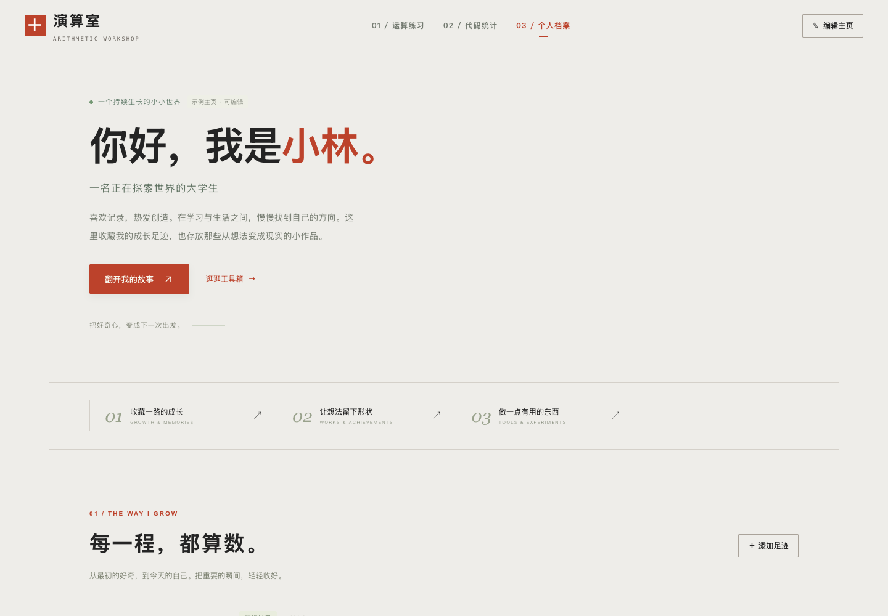

# 演算室 · SoftwareEngineering_Projects

软件工程课程设计，包含个人主页、代码量统计和四则运算练习三个模块。

## 运行

需要 Node.js 18 或更高版本。

Windows 下双击 `启动网站.bat`，浏览器会自动打开页面。运行期间保留命令行窗口。

也可以在项目目录运行：

```bash
npm start
```

访问 <http://127.0.0.1:3000>。网站运行无需安装 npm 依赖；请通过本地服务访问，不要直接打开 `web/index.html`。

## 功能

### 个人主页

- 展示个人简介、成长足迹和作品成就，适配电脑与手机。
- 可以编辑资料，添加、修改和删除记录。
- 资料保存在当前浏览器，页面底部支持 JSON 备份导出与导入。

初始姓名和经历是示例内容。通过“编辑主页”和记录旁的“编辑”替换即可。如果要让其他电脑也显示自己的资料，可以修改 `web/app.js` 中的 `defaults`；浏览器已保存的资料优先于默认数据。

### 代码量统计

- 支持选择文件、文件夹、拖放文件和粘贴代码。
- 支持 JavaScript、TypeScript、Python、C、C++、Java、C#、HTML、CSS、SCSS、JSON、SQL。
- 按课堂表格展示语言、源文件数、代码行数、空行数、注释行数、函数个数，以及函数长度的最大值、最小值、均值、中位数。
- 函数长度排除空行与仅空格/制表符的行，保留签名、括号和注释行；提供函数名、起止行号，方便核对。
- 导出 CSV 语言汇总、JSON 完整报告，或 Excel `.xlsx`（语言汇总、文件明细、函数明细、统计口径四张工作表）。
- 文件在浏览器内读取，自动跳过依赖目录、Git 元数据和构建输出。

行数分类按物理行计算：混合行归代码，纯注释行归注释，空白行单独计算，末尾换行不额外计一行。Python 三引号字符串按代码计。C/C++、Java、Python、C#、JS/TS 使用本地语法树识别函数及注释；其他语言保留基础行数统计。不展开宏或外部文件。语法不完整时会在文件明细提示，缺失的函数指标显示 `—`。

点击“载入五语言示例项目”可以直接查看完整报告。[抽象划分、统计口径与实现流程](docs/代码统计设计.md)。

### 四则运算工作台

默认打开练习工作台。选择“个人档案”可访问原来的成长主页，代码统计继续保留。

- 默认每周 300 题、两个运算符、100 以内；可选 1–10000 题、2–1000 数值上限和 1–3 个运算符。
- 支持括号、负数、整除、分数答案及单运算符带余数除法。
- 单份练习按完整算式去重，后台线程出题，每页 30 题；翻页保留作答。
- 在线计时与批改、正确率、错题重练、浏览器本地成绩记录。
- 文本下载、1–3 列打印、12–100px 行距、可选独立答案页。打印时可选择“另存为 PDF”。
- 分数输入 `1/2`，余数输入 `3余1`；等价分数可正确批改。

命令行复用同一个出题引擎：

```bash
node scripts/generate.mjs --count 300 --max 100 --ops "+-*/" --operators 2 --parentheses --answers --out exercises.txt
```

[需求来源、功能边界与设计](docs/需求与设计.md)。OCR、账号与班级、多语言和万人并发生产服务不在本轮已交付能力内。

## 目录

```text
web/
  index.html              页面入口
  app.js                  页面交互、默认资料与浏览器存储
  logic.js                行数统计、出题与批改
  code-analysis.js        语法树分析与函数长度
  code-report.js          统计口径、语言汇总与 CSV
  code-xlsx.js            Excel 导出
  code-tool.js            代码统计界面
  vendor/                 随网站分发的解析与导出资源
  style.css               样式、响应式布局和打印样式
  assets/                 网站图标
server.mjs                本地静态服务
tests/                    逻辑测试和浏览器测试
preview/                  界面截图
```

## 测试

逻辑测试使用 Node.js 自带的测试工具：

```bash
npm test
```

浏览器测试需要本机安装 Google Chrome。安装开发依赖后，保持本地服务运行，在另一个终端执行：

```bash
npm ci
npm run test:browser
```

测试覆盖五语言函数识别、长度排除空行、跨文件汇总、CSV/JSON/XLSX 导出、表达式求值、多步出题、一万题唯一性、分数和余数批改，以及工作台分页、资料保存、报告下载和手机布局。

## 小组协作

从 `main` 创建功能分支，完成后通过 Pull Request 合并。主页、代码统计和运算练习可以分别推进。Git 已忽略本地录音、整理笔记、转写环境、依赖目录和测试输出。

后续先补充真实个人资料，再按老师给出的细则扩展功能和课程文档。

## 预览



[完整主页](preview/首页-桌面.png) · [手机主页](preview/首页-手机.png) · [代码统计报告](preview/code-report-desktop.png) · [代码统计手机界面](preview/code-report-mobile.png) · [四则运算](preview/四则运算.png)
