# 第14组中期报告

项目：演算室

成员：2024141460236 蒋毅刚；2024141460421 唐梓杰

提交日期：2026年11月4日

## 1 已实现功能

- 选择文件、目录、拖放或公开 GitHub 仓库；按语言分类统计代码、注释、空行。（蒋毅刚）

- 语法树识别函数，统计非空白长度；十一列汇总、语言构成与函数定位；CSV、JSON、XLSX 导出。（蒋毅刚）

- 保存完整报告快照、恢复历史、比较总体和各语言变化，导出对比 CSV。（蒋毅刚）

- 配置数量、范围、运算种类和步数；支持括号、负数、分数及带余数单步除法。（唐梓杰）

- 分页在线作答、计时批改、练习记录、错题重练；未作答题与答错题分别处理。（唐梓杰）

- 错题本展示运算分布及分步计算过程；题目下载和打印，可选择附带答案。（唐梓杰）

- 编辑简介、成长事件与作品，按关键词和标签检索，示例档案可逐步替换。（唐梓杰）

- 创建学习计划，设置日期和优先级；完成状态切换、筛选、排序与编辑。（唐梓杰）

- 档案与学习计划保存在当前浏览器；JSON 备份、恢复及旧版备份导入。（唐梓杰）

- 统一首页、工具页、档案页的视觉与交互；窄屏排版、键盘焦点及减少动态效果。（唐梓杰）

- Web Worker 分担源码分析和题目生成；核心计算与界面分开，便于独立验证。（蒋毅刚）

- 统计口径、建模和代码说明；自动化检查覆盖计算、导出、存储及主要浏览器流程。（蒋毅刚、唐梓杰）

## 2 建模与构建

业务计算在浏览器中完成，Node 提供静态文件，数据保存在 localStorage。record 是数据对象，module 是模块职责。

### 2.1 多语言代码分析与统计解读

责任人：蒋毅刚

把源码视为一组带语言类型的文件，再把“识别语法”“形成指标”“展示和输出”拆成独立职责。增加一种输出格式只需读取 CodeReport；修改函数识别规则集中在分析器中。

用例：UC01 统计项目并定位函数

主要参与者：需要了解项目规模的开发者

目标：获得同一口径的语言统计、文件和函数明细，并导出结果。

前置条件：网站已打开；用户准备源码文件，或可访问的公开 GitHub 仓库链接。

触发条件：选择文件、文件夹，拖放文件，提交仓库链接或载入示例项目。

主成功场景：

1. 界面识别扩展名，跳过依赖、构建输出及不支持的文件，将可分析文件交给 Worker。

2. 分析器加载对应语法，识别注释和函数定义，生成文件记录及函数起止行。

3. 报告模块按语言聚合计数，并使用该语言全部函数的长度计算最大、最小、均值和中位数。

4. 页面切换至报告，展示十一列汇总和语言占比；用户点击长度图中的函数，进入明细定位其文件与行号。

5. 用户可搜索函数、切换长度排序，或导出 CSV、JSON、Excel。三种格式使用同一份报告对象。

异常处理：无法读取的文件单独计为失败；语法不完整时保留行数并说明原因，函数指标显示“—”。仓库访问受限时提示调整链接、稍后重试或下载后本地统计。

使用频率：导入或修改项目后按需使用。

CodeReport 聚合 FileAnalysis；每个文件含零个或多个 FunctionRecord。SourceFile 仅在分析期间携带源码文本，历史报告保留统计和位置。图中的 record 表示普通对象，module 表示 ES 模块的职责；类模型用于说明数据与协作关系。

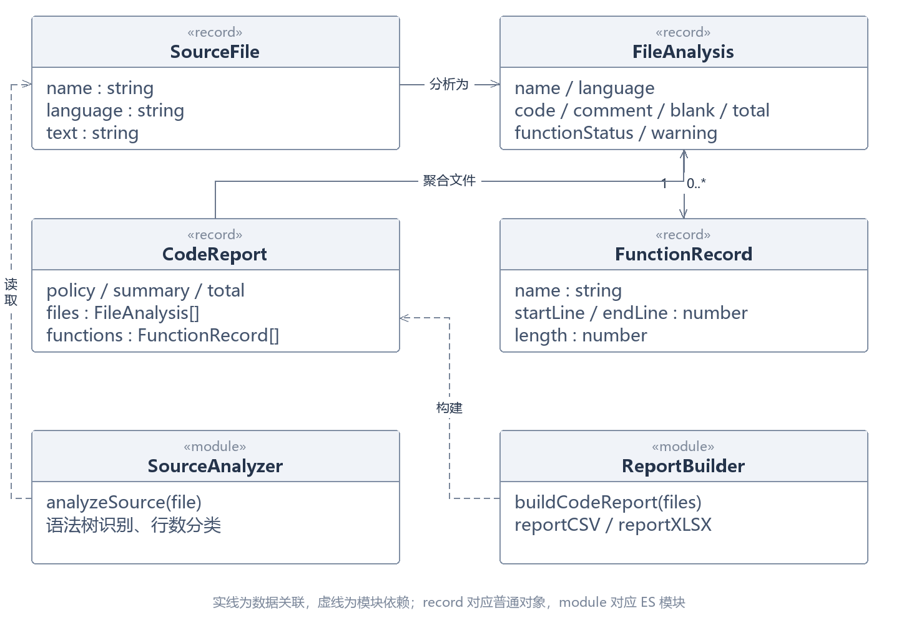

主线程负责文件选择和界面，Worker 完成分析后返回文件记录。单个文件失败不终止其他文件；函数解析不完整会影响相应语言及合计的函数指标，避免以零值掩盖缺失。点击图表仅筛选已有明细，不会重复解析源码。

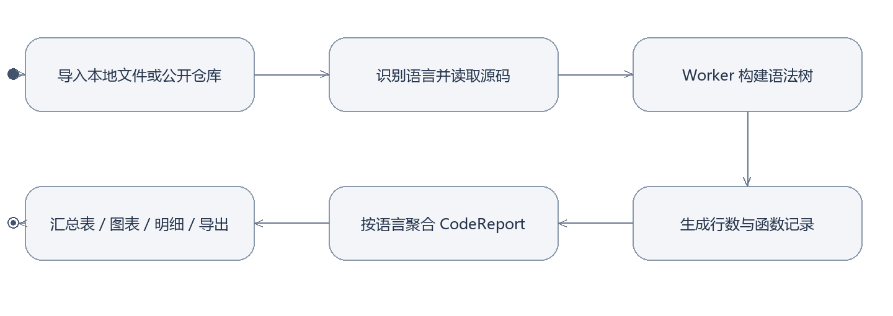

- `web/code-tool.js`：导入、状态、路由与图表定位事件

- `web/github-source.js`：解析仓库链接、固定提交并下载源码

- `web/code-worker.js → code-analysis.js`：Worker 调用分析器并返回结果

- `web/code-report.js`：统一统计口径、全体函数汇总和 CSV

- `web/code-insights.js`：代码占比、较长函数和搜索排序

- `web/code-xlsx.js`：生成具有四张工作表的真实 XLSX

函数长度按定义起止行范围内的非空白行计算，包含签名、括号和注释，排除纯空格、制表符及空行。比如起止范围有 6 行，其中 2 行为空，则长度为 4。无函数时个数为 0，长度指标为空。总均值从全部函数重算；不会把语言均值直接平均。

随项目提供的五语言示例有 5 个文件、44 个物理行，其中代码 35 行、注释 3 行、空行 6 行；共 10 个函数，平均非空白长度为 2.6 行。它用于核对统计口径，不代表实际项目规模。

检查覆盖五种课堂语言、空文件、嵌套函数、多行字符串、语法错误和空白行处理；导出检查读取 XLSX 内的工作表与数值，浏览器检查定位、搜索与返回报告。

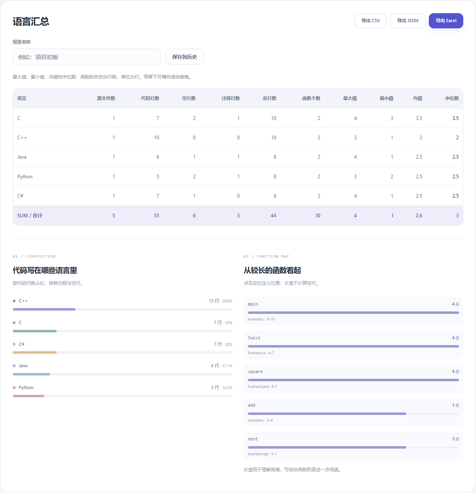

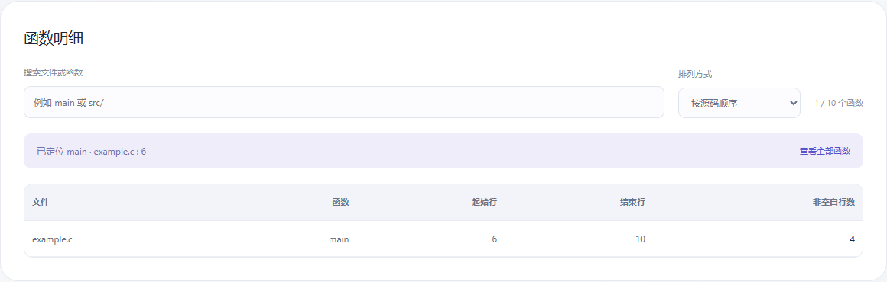

### 2.2 报告历史与版本比较

责任人：蒋毅刚

将一次统计冻结为 ReportSnapshot，把展示、存储和比较分开。比较面向已经生成的报告，不依赖再次访问原文件或仓库；快照采用独立数据副本，后续分析不会改写过去记录。

用例：UC02 保存并比较两份统计报告

主要参与者：需要观察项目变化的开发者

目标：保留某次统计结果，以相同口径比较前后项目规模。

前置条件：已生成报告；进行比较时当前浏览器至少保存两份快照。

触发条件：输入报告名称并保存到历史，或打开版本对比页面。

主成功场景：

1. 用户命名报告，界面根据当前文件记录创建独立快照，写入浏览器本地存储。

2. 用户再次统计更新后的源码并保存，历史列表展示名称、日期、文件数和总行数。

3. 在版本对比页选定基准与新报告，比较模块确认两份报告不同且统计口径一致。

4. 系统计算“新值−旧值”，按总体或语言展示差值；用户可下载对比 CSV。

5. 需要回看时，用户从历史恢复报告，重新查看同一快照的汇总与函数明细。

异常处理：仅有一份报告时提示先保存另一份；选择同一快照或口径不一致时不生成对比。函数指标缺失则差值也为缺失；本地空间不足时提示导出备份，保留原历史。

使用频率：阶段提交或功能迭代后使用。

快照包含完整 CodeReport，ComparisonResult 保存比较得到的指标与语言差值。SnapshotStore、ReportComparator 为逻辑职责，实际纯函数集中在 code-history.js，本地存储与界面事件位于 code-tool.js。报告历史最多保留 10 份。

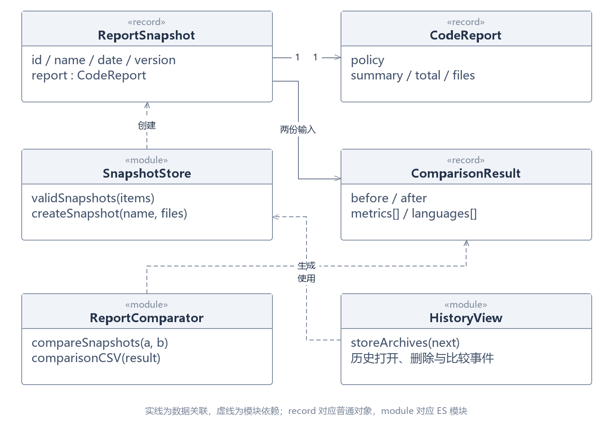

比较操作读取两个快照，统一逐指标取值后相减。缺失值继续传播为 null，页面显示“—”。恢复历史时使用快照中的文件记录重新构建页面；不取最新仓库内容，保证回看的仍是保存时的结果。

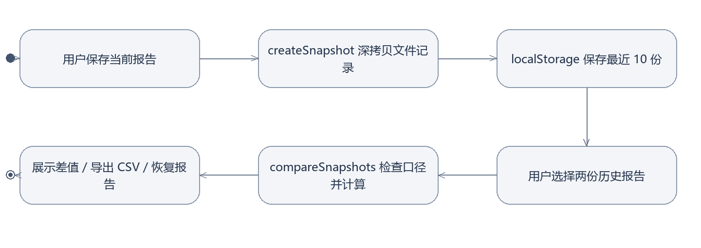

- `web/code-history.js`：快照创建、有效性、比较和 CSV 输出

- `web/code-tool.js`：archiveView、comparisonView 和历史事件

- `web/code-report.js`：快照中的报告结构和统计口径

- `tests/features.test.mjs`：快照独立性、差值及缺失值传播

- `tests/browser/features.spec.mjs`：保存、刷新、比较、下载及恢复操作

历史记录使用 code-report-history 键保存在 localStorage。版本号表示快照格式，policy 记录实际统计口径。比较同一口径的计数可以观察项目规模变化；函数长度或代码行增减本身不能作为质量与个人工作量的结论。

演示文件初版仅有 add 函数，共 2 行代码；改进版扩展 add 并新增 sub，共 5 行代码。比较结果为代码行 +3、函数数 +1。该示例通过实际上传和保存生成，用于说明差值方向。

自动化检查修改源数组后旧快照保持不变；相同快照和口径不符时拒绝比较；浏览器检查刷新后历史仍在、导出差值与表格一致，并能恢复初版。

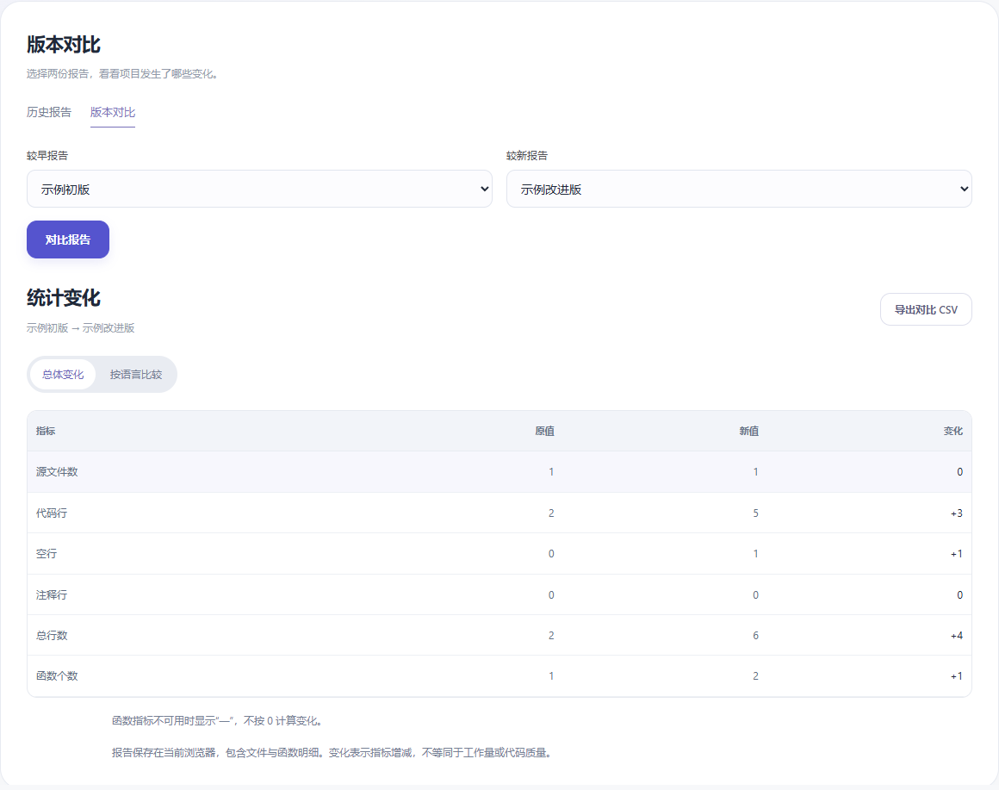

### 2.3 混合运算练习与错题讲解

责任人：唐梓杰

把规则、题目、一次练习和错题记录分成四种数据。出题器和批改器共享表达式求值器，讲解器继续读取同一求值过程，由此保证“题目答案—批改结果—演算步骤”来自相同计算规则。

用例：UC03 完成练习并复习错题

主要参与者：练习四则运算的学生，或编排练习的教师

目标：按规则得到不重复题目，完成作答和批改，通过计算过程巩固错题。

前置条件：网站已打开；出题规则在允许范围内。

触发条件：设置题量、数值范围及运算规则后点击生成练习。

主成功场景：

1. 界面收集配置，由 Worker 生成符合范围、步数和答案规则的题目；默认中间结果非负。

2. 学生分页填写答案，返回设置页或切换页码时，当前会话保留已填内容。

3. 交卷后逐题核对有理数、负数或余数答案，展示正确率和未答数，保存练习记录。

4. 错题本只收录已作答且错误的题；按涉及的运算展示待巩固数量，展开后看到逐步计算。

5. 学生重练错题，答对后标记掌握，再次答错则回到待巩固；也可下载或打印练习。

异常处理：未选择运算或参数越界时指出具体字段；带余数模式只允许单运算符。题目空间不足时提示减少题量或放宽规则，不用重复题补齐。生成失败时保留已有练习。

使用频率：日常练习或课堂编排时使用。

PracticeSession 持有 Question 列表与逐题答案。MistakeRecord 保存同一算式的最近错误输入、累计次数与掌握状态。解释模块使用求值器输出的逆波兰序列和中间有理数；它是确定性计算过程，不需要网络服务。

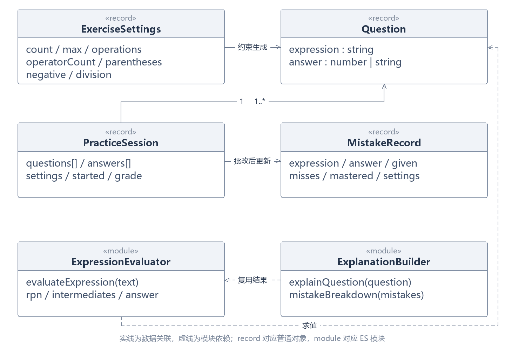

表达式经调度场算法转为逆波兰表达式，再用栈逐步计算。分数统一约分，以分子和分母表示，避免用小数近似判断相等。讲解按实际弹栈顺序给出每一步，例如 2 + 3 × 4 先显示 3 × 4 = 12，再显示 2 + 12 = 14。

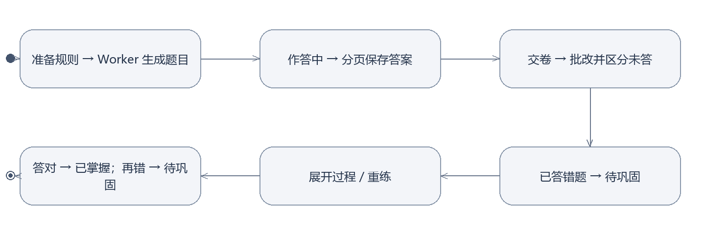

- `web/workshop.js`：设置、会话、分页、计时、批改和打印

- `web/generator-worker.js`：在 Worker 中调用题目生成

- `web/arithmetic.js`：规则检查、去重生成、分数求值与批改

- `web/practice-library.js`：错题收录、掌握和重练题目

- `web/practice-insights.js`：运算分布、优先级与分步计算

- `scripts/generate.mjs`：复用计算模块的命令行出题入口

去重以完整算式为准，交换操作数视为不同题。多运算符题在选择多种运算时包含至少两类运算；带余数除法只生成单步题。待巩固分布表示题目包含哪些运算，一题可同时计入多个类别，不解释为该运算一定是出错原因。

截图使用系统实际生成的 20 题演示，故意将首题填为 999 后交卷。只有这一道已答错题进入错题本，其余未答题单独计数；展开计算过程后可对照答案进行复习。

检查包含运算优先级、括号、负数、等价分数和余数；验证 10,000 道题生成约束、题库不足提示、未答不入错题本、重练状态，以及讲解与求值结果一致。

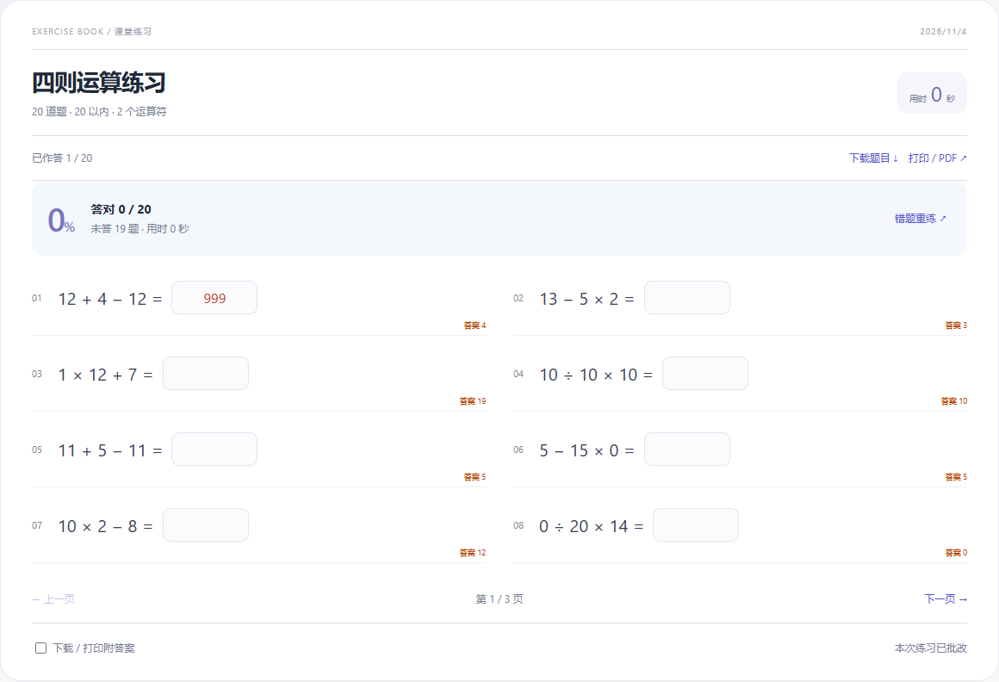

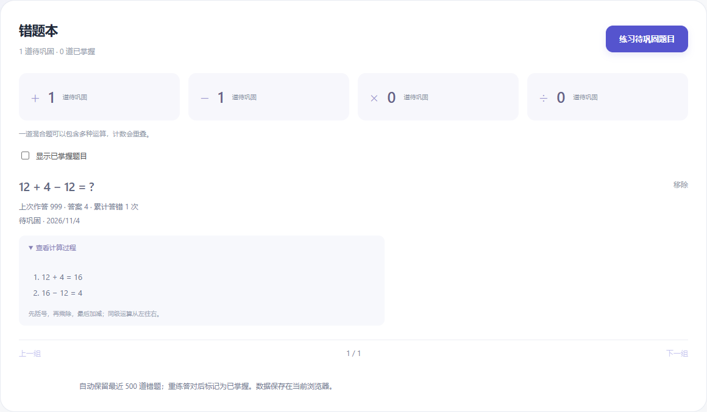

### 2.4 个人档案与学习计划

责任人：唐梓杰

Profile 作为个人档案聚合，包含成长事件、作品和计划。计划只持久化真实业务状态 done；是否逾期由当前日期与 due 推导，避免保存一个会随时间失效的状态。页面筛选只改变显示，不删除数据。

用例：UC04 管理个人学习档案与计划

主要参与者：希望整理成长经历和学习任务的个人用户

目标：在个人主页展示经历、检索作品，把后续学习事项转成可完成的计划。

前置条件：网站已打开；初次使用时可先查看并替换示例档案。

触发条件：点击编辑主页、添加成长事件、添加作品或进入学习计划。

主成功场景：

1. 用户编辑姓名、简介和目标，增删成长事件及作品，保存后页面立即更新。

2. 在作品或成长页输入关键词，结合标签缩小结果范围。

3. 创建计划，填写标题、可选日期、优先级和备注，系统保存并按状态、优先级和日期排序。

4. 用户勾选完成或恢复进行中，通过筛选查看全部、进行中及已完成事项。

5. 通过主页备份按钮导出 JSON，换浏览器后导入恢复简介、记录、作品和学习计划。

异常处理：空标题与不合法日期由表单指出；导入格式不正确时提示重新选择。存储失败时提示当前浏览器未能保存，用户可导出已有资料。旧备份缺少 plans 时按空列表读取。

使用频率：学习任务变化或记录新经历时使用。

Profile、GrowthRecord 和 WorkRecord 对应 app.js 中的对象；LearningPlan 对应 learning.js 使用的记录。LearningController 通过保存回调更新聚合，界面与存储职责解耦。模型名称说明职责，不额外引入数据库与服务端业务接口。

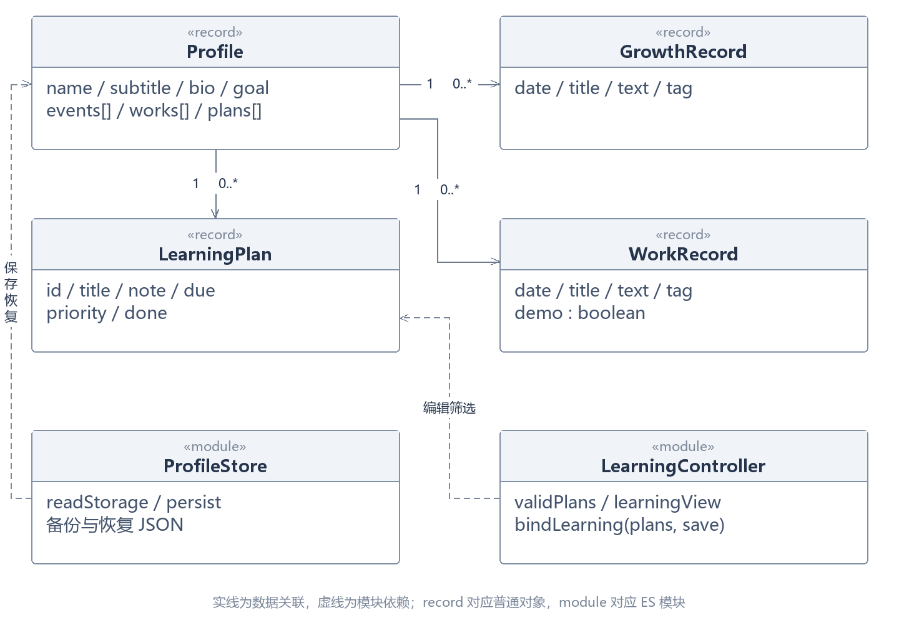

用户的编辑经保存回调产生新列表，统一写回个人档案。进行中计划排在已完成计划前，优先级高的靠前，随后按日期排序；无日期任务置后。页面每次展示时计算逾期，不把显示结果写回存储。

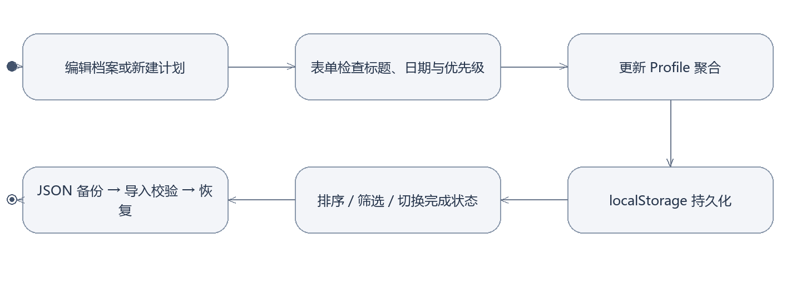

- `web/app.js`：档案对象、编辑弹窗、成长作品筛选及备份恢复

- `web/learning.js`：计划字段、排序、筛选与编辑事件

- `web/index.html`：全局导航、弹窗和语义化结构

- `web/studio.css`：统一视觉、响应式排版、动效与焦点

- `tests/browser/features.spec.mjs`：计划保存、刷新、备份恢复及旧备份读取

本地档案使用 growth-garden-profile 键保存；页面明确标记示例内容，编辑后再展示个人资料。首页的本机学习足迹读取实际保存的练习、报告和计划数量，不使用固定的虚拟进度。不同浏览器之间使用 JSON 备份迁移。

计划截图通过界面添加两项演示任务，并勾选其中一项完成；个人主页继续保留“示例主页”提示，便于正式展示前替换真实经历与作品。

浏览器检查新增、编辑、完成和刷新持久化，验证计划随档案恢复；同时检查旧版备份导入、成长作品筛选，以及 390px 窄屏布局。

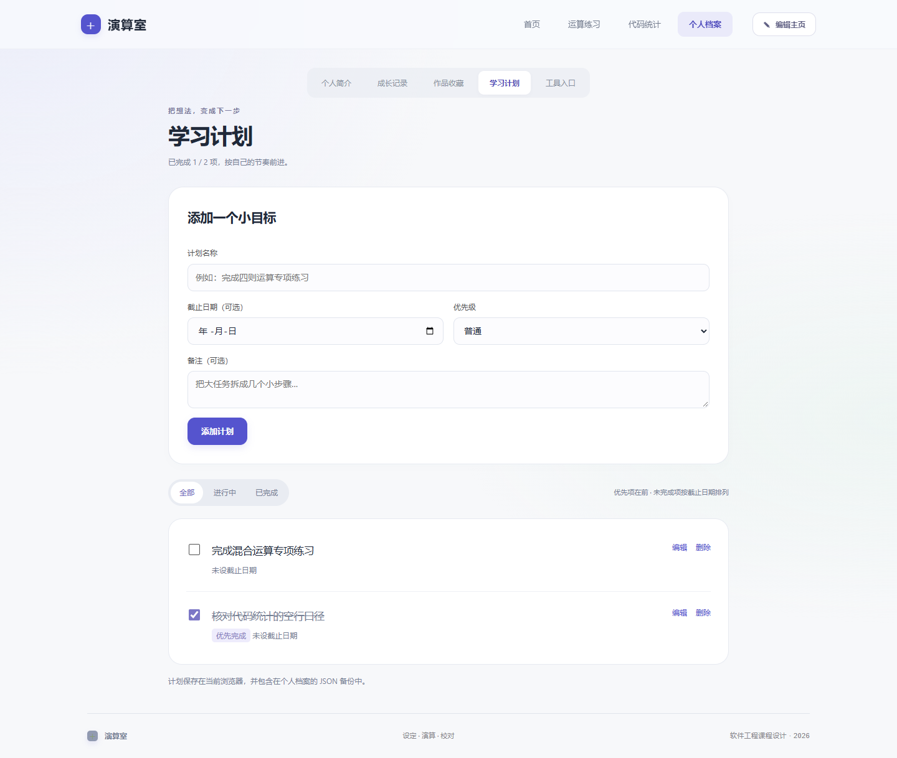
