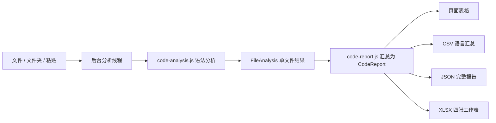

# 代码统计：抽象与实现

## 要解决的问题

导入一批源码，按语言统计源文件数、代码行数、空行数、注释行数、函数个数，以及函数长度的最大值、最小值、均值和中位数。页面表格对应课堂示例中的十列。输出提供 CSV、JSON、Excel 三种形式。

函数长度按老师补充的要求排除空行。先固定这个含义，再实现算法；否则不同输出即使数字一致，也可能统计的是不同东西。

## 统计口径

- **行数分类**：按物理行划分，代码、空白、纯注释互斥。同一行同时有代码与注释时归代码。文件末尾的换行符不额外增加一行。Python 三引号字符串属于代码。
- **函数**：识别有实现的函数、方法、构造器和析构器。忽略原型声明、抽象方法、调用表达式和控制语句。嵌套函数各计一次。JS/TS 的箭头函数、匿名函数计入；C/C++/Java/C# 的 lambda 和 C# 属性访问器不计入。
- **函数长度**：从语法树中定义的首行到末行，逐行去除空白后计数。包含签名、花括号和注释行，排除空行和仅空格、制表符的行。Python 装饰器在函数定义节点之外，不计入。外层函数的长度包含内层函数所在的行。
- **均值**：同一语言的全部函数长度之和除以函数个数，保留两位小数。
- **中位数**：长度排序后取中间值；偶数个函数取中间两个长度的平均。
- **无函数**：函数个数为 0，四个长度指标为空。界面显示 `—`，CSV 空单元格，JSON `null`，Excel 空单元格。
- **不完整分析**：源码存在语法错误时保留行数和可识别函数明细，并标明状态；所在语言及合计的函数指标为空，避免把缺失数据当成 0。未支持函数分析的语言也同样标明原因。
- **语言识别**：C、C++、Java、Python、C# 分开统计；`.h` 默认 C，`.hpp/.hxx/.hh` 归 C++。粘贴模式可直接选择 C++。JS/TS 同样支持函数分析；HTML、CSS、SCSS、JSON、SQL 保留基础行数统计。

C/C++ 按源文件语法分析，不执行预处理、不展开头文件或宏，也不将结果解释为编译后程序中的函数数量。Java/C# 按文件内的定义统计，不做跨文件类型解析。

## 抽象思想

把问题分成“输入源码”“识别源码结构”“汇总数据”“输出报告”四件事。

`SourceFile` 表示一份输入，包括文件名、语言和文本。分析后变成 `FileAnalysis`，保存行数分类、函数列表和分析状态。每个 `FunctionRecord` 只保存函数名、起止行号和排除空行后的长度。`CodeReport` 再组合所有文件，产生语言汇总、文件明细、函数明细和统计口径。

这些是数据记录和模块职责，用普通对象及纯函数表达即可。没有为每个语言、每种导出格式再建一套重复的业务流程。



不同语言的差异收在语法配置中：使用哪份语法、哪些节点算函数。共同的行数分类和聚合过程复用。输出端只接收报告，不重新读取或解析源码。这体现了关注点分离，也避免“Excel 的均值”和“页面的均值”各算一遍后出现差异。

## 实现流程

1. `code-tool.js` 接收文件，识别扩展名，跳过依赖、构建目录和第三方资源。一次导入替换上一次结果。
2. `code-worker.js` 在 Web Worker 中调用分析器，逐文件返回结果，主线程保持可操作。
3. `code-analysis.js` 按需加载本地 Tree-sitter WASM。语法树区分注释、字符串和函数，避免仅凭括号或正则把调用误认为定义。
4. 对注释节点覆盖的字符做空白替换，保留换行。将原始行与替换后的行对照，就能得到代码、注释、空白三类互斥行数。
5. 对函数节点取得起止行号，遍历覆盖的源码行，只累计 `line.trim()` 非空的行数。源码没有执行，分析只读取结构。
6. `code-report.js` 按语言合并文件，汇集函数长度列表，计算极值、均值和中位数。合计基于所有函数重算，不取各语言均值的平均。
7. 页面渲染报告，下载按钮将同一数据送入不同输出函数。切换页面后再次返回，当前结果仍在内存中。

语法资源只在首次遇到对应语言时加载，后续复用；单文件的语法树与解析器使用完释放。排序只用于长度中位数和文件显示，不额外扫描磁盘。

## 输出设计

| 格式 | 内容 | 用途 |
| --- | --- | --- |
| CSV | 与页面相同的十列语言汇总、合计 | 直接导入表格软件、整理实验数据 |
| JSON | 口径、汇总、文件与函数明细、状态 | 程序读取、复核和后续处理 |
| Excel `.xlsx` | 语言汇总、文件明细、函数明细、统计口径 | 课堂展示、筛选与追溯 |

XLSX 使用 Office Open XML 结构：数值写为数值单元格，文本写为字符串，首行冻结并加筛选。由 fflate 打包 ZIP，文件不是改扩展名的 CSV 或 HTML。添加新格式只需消费 `CodeReport`，无需改分析器。

Excel 和 JSON 包含文件路径、函数名、起止行及规则，因此发现异常数字时可以回到对应源码核对；CSV 保持课堂表格要求的十列。

## 一个可以手算的例子

```c
int add(int a, int b) {

    return a + b;
}
```

定义覆盖 4 个物理行，第 2 行为空，函数长度为 **3**。如果同语言的另一个函数长度为 6，则函数个数为 2，最大 6、最小 3、均值 4.5、中位数 4.5。

页面的“载入五语言示例项目”使用公开在 `web/code-samples.js` 中的样例，方便展示和手算；不将示例数字当作用户项目的结果。

## 模块和检查位置

| 文件 | 职责 |
| --- | --- |
| `code-analysis.js` | 语法树读取、行分类、函数识别与长度 |
| `code-worker.js` | 将计算放到后台线程 |
| `code-report.js` | 指标口径、汇总、CSV 数据 |
| `code-xlsx.js` | Excel 工作表与打包 |
| `code-tool.js / .css` | 输入、进度、结果表格和下载交互 |

逻辑测试包含五种课堂语言、空行排除、空文件、无函数、构造器、抽象方法、嵌套函数、注释符号字符串、语法错误、多文件均值和偶数中位数。导出测试检查同一数据在 CSV、JSON、XLSX 中的值。浏览器测试覆盖真实下载、源码上传、结果保留及手机表格滚动。

依赖来源：[Tree-sitter 浏览器接口](https://github.com/tree-sitter/tree-sitter/tree/v0.25.10/lib/binding_web)、[VS Code 语法 WASM](https://github.com/microsoft/vscode-tree-sitter-wasm)、[C 语法](https://github.com/tree-sitter/tree-sitter-c)、[fflate](https://github.com/101arrowz/fflate)。版本及许可见 `web/vendor/README.md`。
