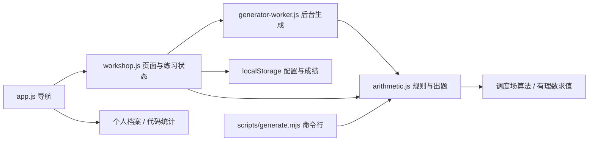
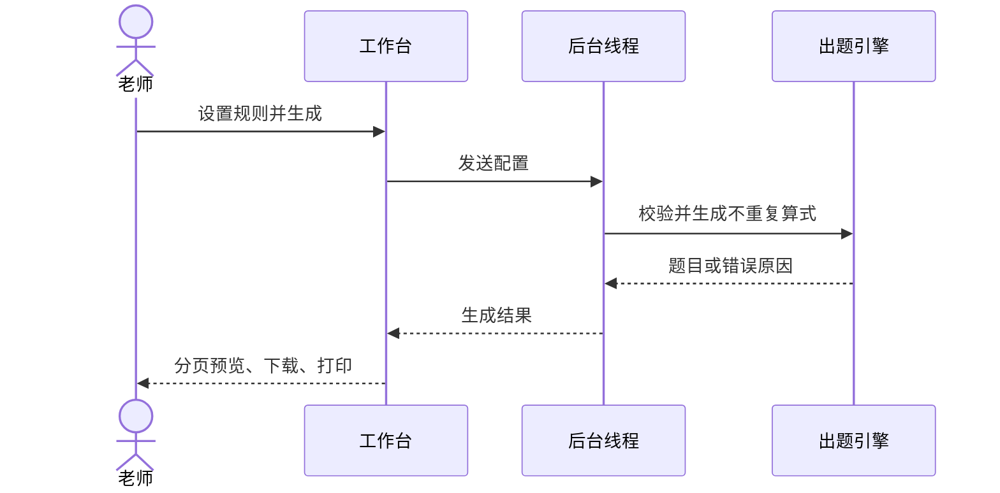

# 演算室：需求与设计

依据：用户提供的四张课堂投影片与 `20261014_164950.m4a` 课堂录音。录音通过本地 Whisper small 自动转写，部分人名和术语识别不准，以下只整理语义清楚的要求；不把课堂中“发博客”等指令当作发布授权。

## 录音中的重点

- 00:07–00:41：可以使用 AI，但应体现自己的需求分析、检查和扩展工作。
- 01:23–02:26：细化代码量统计，以及个人或小组主页展示的具体内容；原型仍需要细致检查。
- 03:34–03:56：梳理、规划需求，小组自行协调工作量。
- 03:56–04:26：报告简洁，控制在 50 页以内，30 页以内也可，体现课程建模内容。
- 04:39–05:20：说明可扩展性、可维护性；挑选具体用例，提供少量有代表性的类图或顺序图。

人员、分工和实际工时应由小组填写，不在文档中虚构。报告模板尚未确定，本文是可补充的设计底稿。

## 功能范围与验收

| 要求                              | 本次实现与验收方式                                                           |
| --------------------------------- | ---------------------------------------------------------------------------- |
| 每周 300 题、两个运算符、100 以内 | 默认配置；测试完整生成 300 道算式                                            |
| 答案 0–100                        | 非负默认；最终值受上限约束；中间值保持非负，允许大于上限                     |
| 运算、括号、负数、分数、余数      | 1–3 运算符；可选括号、负数；整除/分数/余数模式；余数只用于单运算符           |
| 题目避免重复                      | 单份练习内完整算式字符串去重；交换操作数仍视为不同题；不同练习之间不承诺去重 |
| 数量可定制、生成一万题            | 1–10000；浏览器后台线程生成，每页 30 题；测试验证 10000 个唯一算式           |
| 打印可定制                        | 1–3 列、12–100px 行距、独立答案页；浏览器打印可另存 PDF                      |
| 正确率、历史、计时                | 在线批改，未答单列；错题重练；最近 30 次成绩存于本浏览器                     |
| 命令参数                          | `scripts/generate.mjs` 与网站复用同一出题引擎                                |
| 个人主页、代码统计                | 保留原有浏览器资料编辑、导入导出和代码统计模块                               |
| 多语言、24 点、OCR                | 课堂列为扩展示例，本轮不将其标记为已完成                                     |
| 一万用户并发                      | 本地服务未验证生产并发；出题在客户端进行，但不等于已支持一万并发             |

分数模式当前使用整数操作数，允许分数结果；不生成分数操作数。整除模式每一步都必须整除。负数开关允许减法的负数中间值和最终值，但操作数仍为非负整数。基础单运算符整除模式保留九九乘法范围，多步模式按所选数值上限生成。题库不足时明确报错，不补重复题。随机多步生成采用有限尝试，提示找到的数量不是理论最大容量。

## 核心用例：老师生成周练

参与者：老师。前置：打开本地网站。默认规则为 300 题、两个运算符、加减法、上限 100。

1. 老师修改数量、范围、运算或打印布局。
2. 提交配置。浏览器校验输入；后台线程验证语义并生成练习。
3. 成功后分页展示；可直接下载文本、打印或另存 PDF。
4. 勾选附答案后，打印答案独立分页。

异常：未选运算、带余数选择多运算符或题库不足时展示具体原因，保留原练习。下载/打印使用已生成的题目，不重新出题。

学生用例：逐页作答 → 交卷 → 系统显示正确率、未答、用时 → 错题重练。翻页保留输入，交卷批改整份练习。

## 结构与行为

纯计算模块与 DOM、存储分离，浏览器和 CLI 共用。算式通过调度场算法转成逆波兰表达式，用约分后的有理数求值，避免 eval 与小数累积误差。批改接受等价分数和小数；余数按“商余余数”格式判分。

## 验证与后续边界

执行 `npm test` 检查基础统计、表达式优先级、括号、除零、分数批改、周练及一万题唯一性。执行 `npm run test:browser` 检查桌面/手机、导航、个人资料、代码统计、分页、批改、错题、下载和打印结构。

生产服务扩展需另行设计身份与班级、作业数据持久化、权限、负载测试、缓存/CDN、监控与部署。OCR 要评估印刷体和手写体识别率，提供人工确认，再送入同一求值与批改模块。上述能力没有通过假按钮或虚构测试数据表示为已完成。

2026-10-21 本地验证：16 项逻辑测试、4 项浏览器流程测试通过；输出 A4 两页打印样张，第一页为 20 道练习，第二页为参考答案。桌面和 390px 手机视口均检查过。命令行生成与网站复用同一引擎。
